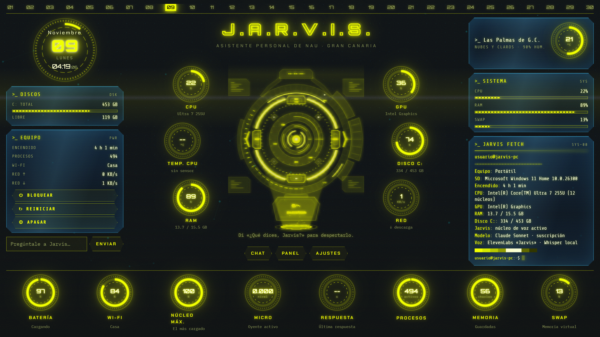
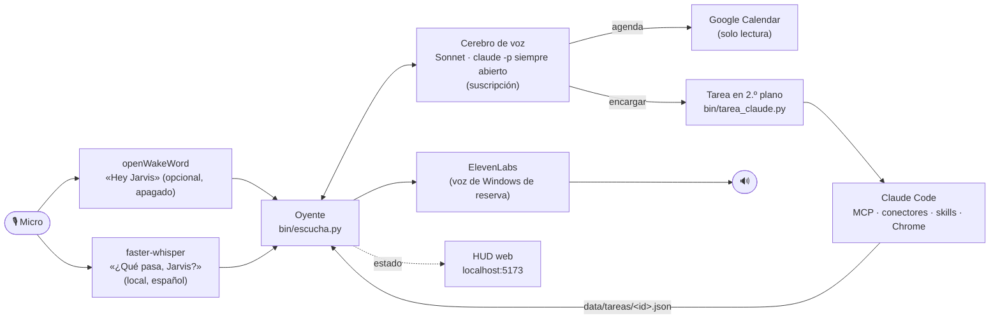

# Jarvis · asistente de voz con Claude para Windows

Asistente de voz manos libres en **español** para **Windows 11**. Le dices «¿Qué pasa, Jarvis?», hablas con él como con una persona y, cuando le pides **hacer** algo en el ordenador («ordena Descargas», «prepárame un correo para…», «en el proyecto de LinkedIn, redacta el post de hoy»), lo encarga a **Claude Code en segundo plano**, con todos sus MCP, conectores y skills, y te avisa por voz al terminar.

Funciona con la **suscripción de Claude** (Pro o Max): ni la voz ni las tareas usan la API de pago por uso.

[](docs/presentacion.pdf)

**[📑 Presentación (PDF)](docs/presentacion.pdf)** · **[🛠️ Guía de instalación paso a paso](docs/INSTALACION.md)** · **[🧭 Arquitectura](docs/arquitectura.md)** · **[🔐 Seguridad y privacidad](docs/seguridad.md)**

> Proyecto personal en uso diario desde el 06/11/2026. Está montado sobre [OpenJarvis](https://github.com/open-jarvis/OpenJarvis) (Apache 2.0) y este repo publica mis scripts y mis cambios, no un producto empaquetado.

## Qué hace

| Le dices | Jarvis |
|---|---|
| «¿Qué pasa, Jarvis? ¿Qué tengo mañana?» | Consulta tu Google Calendar (solo lectura) y te lo cuenta |
| «¿Qué tiempo hace en Madrid el sábado?» | Busca en la web y responde en una o dos frases |
| «Organiza la carpeta de Descargas» | Dice «me pongo con ello», Claude Code lo hace en segundo plano y Jarvis te avisa al acabar |
| «En el proyecto de LinkedIn, prepara el post del lab de hoy» | La tarea arranca **dentro de esa carpeta**, con su `CLAUDE.md`, memoria y skills |
| «Envía el correo a…» | Lo prepara y **te pide permiso por voz** («¿Lo hago?») antes de enviar nada |
| *(le interrumpes mientras habla)* | Se calla y te escucha (distingue tu voz de su propio eco) |

## Por qué es distinto

Hay otros proyectos que juntan voz y Claude Code; el más conocido es [ethanplusai/jarvis](https://github.com/ethanplusai/jarvis), para macOS. Este se diferencia en cinco puntos:

- **Windows y español.** Lo despiertas con una sola frase, «¿Qué pasa, Jarvis?» (vale también «¿Qué dices, Jarvis?», como suele escribirla Whisper), que se transcribe en local; el nombre se reconoce por similitud fonética aunque lo escriba mal. Solo esa frase lo despierta: nombrarlo mientras hablas de otra cosa no. «Hey Jarvis» (openWakeWord) viene desactivado y se puede encender en `escucha.py`.
- **Confirmación obligatoria.** Enviar, publicar, pagar o borrar nunca se hace a la primera, porque una falsa activación de voz no puede tener consecuencias. Claude Code deja la tarea en `CONFIRMAR`, Jarvis te lo pregunta y solo con tu «sí» se reanuda la sesión. El script solo acepta la confirmación de un permiso que Jarvis ya te ha preguntado, de esa misma sesión, reciente y de un solo uso, así que una inyección de prompt no puede pedir una acción nueva «ya confirmada».
- **Sin API de pago.** Los procesos de Claude se lanzan sin `ANTHROPIC_API_KEY` ni variables de Bedrock o Vertex, así que siempre usan la sesión de claude.ai.
- **Privacidad.** El audio se transcribe en el PC. Lo que el micro oye sin «Jarvis» no se guarda: solo el número de palabras y el volumen máximo.
- **Pensado para estar siempre encendido.** Arranca solo al iniciar sesión, un vigilante lo levanta si se cae cada 5 minutos, solo puede haber un oyente a la vez y libera RAM cuando hace falta.

## Cómo funciona



1. **Oído.** `escucha.py` escucha el micro en local. Se activa solo con «¿Qué pasa, Jarvis?» al principio de una frase (Whisper y similitud fonética). «Hey Jarvis» (openWakeWord) está apagado por defecto (`WAKE_BY_HEY_JARVIS`).
2. **Cerebro.** Una sesión de `claude -p` en modo *stream-json* que nunca se cierra, con Sonnet, sin MCP ni plugins y con solo tres herramientas permitidas: búsqueda web, lectura web y `jarvis-herramienta`. Contesta en unos segundos y la voz empieza con la primera frase, sin esperar al resto.
3. **Manos.** Lo que hay que *hacer* se lanza como `claude -p` aparte, con todo tu entorno de Claude Code, el modo de permisos `auto` y tu Chrome (`--chrome`). Las tareas de ejemplo tardaron una mediana de **30 s**.
4. **Voz.** ElevenLabs sintetiza frase a frase mientras el cerebro escribe. Si falla, lee la respuesta la voz de Windows.
5. **Reservas.** Si Sonnet falla o se llega al límite del plan, contesta Haiku por OpenRouter a través de la API de OpenJarvis.

Más detalle, con el flujo de confirmación y los procesos, en [docs/arquitectura.md](docs/arquitectura.md).

## Qué demuestra este proyecto

- **Integración de sistemas en Windows**: procesos en segundo plano sin ventanas, una tarea programada que vigila los servicios, un mutex de instancia única, Job Objects para cerrar procesos hijos y la API PDH para medir la CPU igual que el Administrador de tareas.
- **Audio en tiempo real**: detector de voz con suelo de ruido adaptable, búfer previo de 0,6 s, troceo con solape para frases largas, interrupción del usuario (*barge-in*) con cancelación de eco de verdad (AEC3 de WebRTC: resta del micro lo que está sonando, así funciona también con altavoz) y cambio automático de micrófono.
- **Orquestación de LLM**: un modelo de voz rápido y siempre caliente, más agentes de trabajo aislados, con reanudación de sesiones y un hilo de conversación que dura 5 minutos.
- **Seguridad por diseño**: confirmación humana para acciones irreversibles, mínimo privilegio para el cerebro de voz, OAuth de Google reducido a `calendar.readonly` y ningún dato personal en el código (todo va en `data/usuario.toml`).
- **Operación**: un historial de incidencias real, con síntoma, causa y arreglo ([CHANGELOG.md](CHANGELOG.md)), y una guía de diagnóstico ([docs/solucion-de-problemas.md](docs/solucion-de-problemas.md)).

## Estructura del repositorio

```text
jarvis-claude-voice/
├── bin/                       # Jarvis: oyente, cerebro, tareas, vigilante y lanzadores
│   ├── escucha.py             # Oyente manos libres (wake word, VAD, voz, barge-in, tareas)
│   ├── cerebro_claude.py      # Sesión de Sonnet siempre abierta (suscripción)
│   ├── tarea_claude.py        # Ejecuta una tarea con Claude Code en segundo plano
│   ├── herramientas_voz.py    # Lo único que puede ejecutar el cerebro: agenda y encargar
│   ├── ajustes.py             # Lee data/usuario.toml (nombre, perfil, carpetas)
│   ├── vigilante.ps1          # Levanta la API, la web y el oyente si se caen
│   └── …                      # micro, memoria de voz, RAM, arranque oculto
│                              # (escriba_activo.py y parte de liberar-ram.ps1 son de mi
│                              #  dictado «Escriba»: si no lo tienes, no hacen nada)
├── openjarvis-overlay/        # Archivos de OpenJarvis que Jarvis cambia o añade (HUD incluido)
│   ├── cambios-openjarvis.patch
│   └── UPSTREAM_COMMIT        # Versión de OpenJarvis con la que está probado
├── config/                    # Plantillas: usuario.toml, config.toml y SOUL.md
├── scripts/                   # Aplicar el overlay, guardar claves, escáner de secretos, sincronizar
├── docs/
│   ├── INSTALACION.md         # Paso a paso, de cero a «¿Qué pasa, Jarvis?»
│   ├── arquitectura.md
│   ├── seguridad.md
│   ├── solucion-de-problemas.md
│   └── presentacion.pdf
└── assets/img/
```

## Instalación

Resumen; el paso a paso completo, con lo que deberías ver en cada paso, está en **[docs/INSTALACION.md](docs/INSTALACION.md)**.

1. Instala Claude Code e inicia sesión con tu cuenta de Claude (Pro o Max).
2. Clona OpenJarvis en la versión de [`UPSTREAM_COMMIT`](openjarvis-overlay/UPSTREAM_COMMIT) y aplica el overlay con `scripts\aplicar-overlay.ps1`.
3. Instala las dependencias de Python con `uv` y las de la web con `npm`, y añade openWakeWord.
4. Copia `bin\` y las plantillas de `config\` a tu carpeta `jarvis`, y rellena `data\usuario.toml`.
5. Guarda las claves (ElevenLabs y, si quieres reserva, OpenRouter) con `scripts\configurar-claves.ps1`.
6. Arranca con `bin\jarvis-arranque.vbs`, registra el vigilante y di «¿Qué pasa, Jarvis?»

**Requisitos:** Windows 10/11, una suscripción de Claude Pro o Max, Git, Node.js 22 o superior, [uv](https://docs.astral.sh/uv/) y un micrófono. Opcionales: ElevenLabs para la voz, OpenRouter para la reserva y un proyecto de Google Cloud para el calendario.

## Stack

- **Python 3.11**: oyente y scripts. Usa `sounddevice`, `numpy`, `openwakeword`, `faster-whisper` y `livekit` (solo su cancelación de eco).
- **Claude Code** (`claude -p`, *stream-json*, `--resume`, `--chrome`) con Sonnet por la suscripción.
- **OpenJarvis**: API FastAPI, herramientas, conectores y web en React + Vite.
- **TypeScript + Canvas**: HUD holográfico con datos reales del PC.
- **PowerShell y VBScript**: arranque oculto, vigilante y tarea programada.
- **ElevenLabs** (voz), **OpenRouter** (reserva), **Open-Meteo** (tiempo) y **Google Calendar API** (agenda).

## Aprendizajes

- **Una activación de voz no es una orden firmada.** Con el micro siempre abierto habrá falsas activaciones. Por eso lo irreversible pide confirmación, y la marca de confirmación la pone el código, no el texto dictado.
- **Que el sistema sea rápido de oír importa más que la velocidad del modelo.** Pasar de esperar la respuesta completa a hablar frase a frase notó más que cambiar de modelo.
- **Los fallos de un asistente de voz son casi siempre de audio, no de IA.** Micrófonos que mandan ceros en silencio, frases cortadas a los 6 s, dos oyentes a la vez… el [historial](CHANGELOG.md) lo cuenta con detalle.
- **`pythonw.exe` no siempre significa «sin ventana».** El del entorno virtual de uv es un lanzador que abre el `python.exe` con consola. Las tareas se lanzan con el `pythonw.exe` real.
- **Una clave de API con límite propio puede fallar aunque la cuenta tenga saldo.** ElevenLabs respondía 401 con 74.000 créditos disponibles, porque la clave estaba limitada a 10.000.

## Licencia

Mi código es [MIT](LICENSE). Los archivos de OpenJarvis incluidos en `openjarvis-overlay/` siguen siendo Apache 2.0: lo explica [NOTICE.md](NOTICE.md).

---

Hecho por **Nauzet Doreste** ([@ndoreste](https://github.com/ndoreste)), estudiante de 2.º de ASIR y del Máster en Ciberseguridad.
