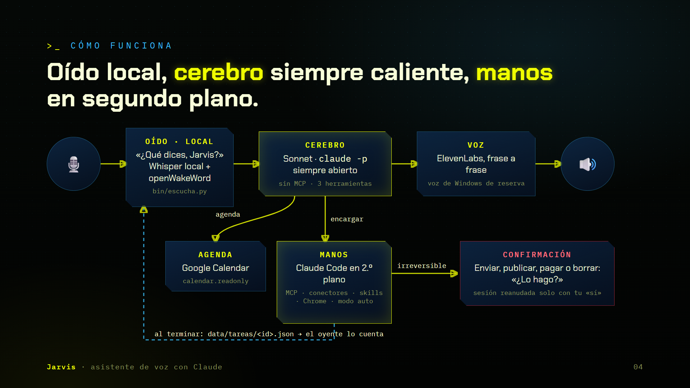
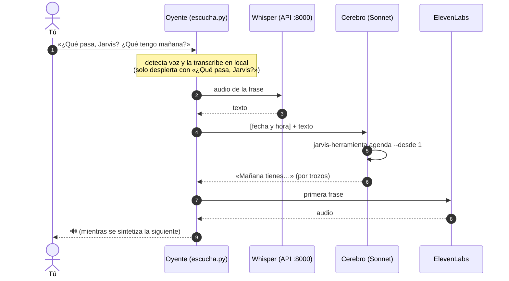
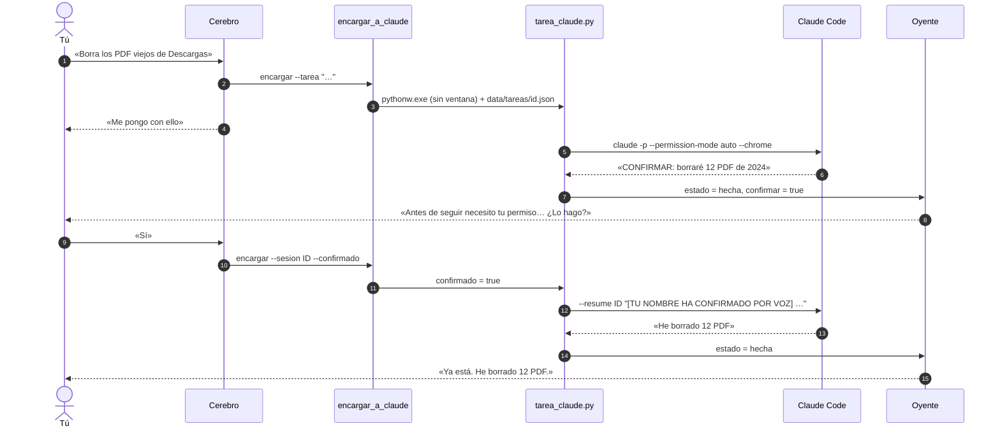

# Arquitectura

Jarvis son cuatro procesos que se arrancan solos y se vigilan entre sí, más un proceso de Claude Code por cada tarea.

## Procesos

| Proceso | Qué es | Lo arranca | Puerto / archivo |
|---|---|---|---|
| **API de OpenJarvis** | FastAPI: Whisper, herramientas (`agenda_google`, `encargar_a_claude`), conectores, API del HUD y el modelo de reserva | `jarvis-arranque.vbs` y el vigilante | `:8000` |
| **Web del HUD** | React + Vite: el HUD en `/` y el chat en `/chat` | `jarvis gui` y el vigilante | `:5173` |
| **Oyente** | `bin/escucha.py`, con el `pythonw.exe` del entorno virtual para que no tenga ventana | `jarvis-arranque.vbs` y el vigilante | `data/escucha.log` |
| **Cerebro de voz** | `claude -p` en *stream-json* que nunca se cierra (~185 MB) | El oyente, atado a él con un Job Object | `data/cerebro/` (carpeta vacía) |
| **Tarea** | `claude -p` con todo el entorno de Claude Code, una por petición (máximo 3 a la vez) | La herramienta `encargar_a_claude` | `data/tareas/<id>.json` |

La tarea programada **«Jarvis vigilante»** (`bin/vigilante.ps1`) se ejecuta cada 5 minutos y al iniciar sesión, y levanta la API, la web o el oyente si no responden. Después llama a `liberar-ram.ps1`, que cierra servidores MCP huérfanos y limpia `%TEMP%` una vez al día.

## Una conversación, paso a paso

- **Detección de voz.** El suelo de ruido se adapta, y tras un silencio digital (micrófonos que mandan ceros) la primera voz se detecta con el umbral mínimo. Se guardan 0,6 s de audio previo para no perder el principio de la frase.
- **Frases a medias.** Si la frase acaba en «que», «para», «y»… espera hasta 3 s más. Los tramos de más de 6 s se trocean con 2 s de solape.
- **Interrupción.** Mientras Jarvis habla, el micro sigue abierto. Si hablas unos 0,4 s seguidos, se calla, y ese audio es el principio de tu turno.
- **Hilo.** Si vuelves a llamarle antes de 5 minutos, sigue la conversación anterior. Si pasa más tiempo, empieza de cero.

## Una tarea, paso a paso

- **Proyectos.** Si dices «en el proyecto de X», `tarea_claude.py` busca en tu carpeta de proyectos la subcarpeta que más se parece (sin tildes, sin espacios y con coincidencia aproximada) y lanza Claude Code dentro de ella, así que carga su `CLAUDE.md`, su memoria y sus skills.
- **Jarvis es el protagonista.** El cerebro y la tarea tienen la instrucción de hablar en primera persona y no nombrar nunca a Claude ni a Claude Code. Los errores técnicos se dicen sin nombres, y el detalle queda en el campo `detalle` del JSON de la tarea.

## Reservas

| Falla | Qué pasa |
|---|---|
| Sonnet no contesta (límite del plan, red) | `respuesta.py` pide la respuesta a la API de OpenJarvis (Haiku por OpenRouter) |
| ElevenLabs rechaza la voz | Jarvis avisa y lee la respuesta con la voz de Windows (SAPI) |
| El oyente o la API se caen | El vigilante los levanta en 5 minutos como mucho |
| Se cambia el micrófono | El oyente usa siempre el predeterminado de Windows y cambia solo en 5–10 s |
